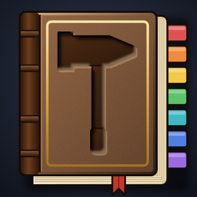

<h1 align="center">ForeverProfessional</h1>

<b>Every profession recipe in World of Warcraft: Forever in one window: which ones your characters already know, and exactly where to get the rest.</b>

Blizzard's profession window only lists the recipes you have learned. ForeverProfessional ships a full catalog of over 2,100 recipes, including the 900+ added in Forever, with the trainer, vendor, quest, drop or chest that teaches each one.

## Features

- **Every profession.** Browse all recipes by category, in their difficulty colour for your skill. Filter by All, Learned or Missing, or search by name.
- **Filters.** Narrow the list to recipes that still give you skill, recipes you can learn now, recipes from a trainer, vendor, drop, quest or other source, or recipes new in Forever. Your choices are remembered.
- **Where to get it.** Each recipe you don't know leads with its sources:
  - trainers, with the training cost
  - vendors, with any reputation or Merchant's Favor requirement
  - quests, with their level
  - drops, with the drop rate when it is known
  - chests and other objects
- **Waypoints.** One click puts a map pin on the NPC or object, when its location is known.
- **Materials calculator.** Enter how many of a recipe you want and get the raw materials to buy or farm, the crafts in order with which of your characters can make each, and the reagent tree. Reagents you or an alt can craft are crafted; switch any of them to buy. What's in your bags and bank is subtracted.
- **Tracked recipes.** Track several recipes, each with a quantity, and get one shopping list for all of them, shared by all your characters. Item tooltips say which tracked recipe needs the item and how many, and each craft counts its recipe down.
- **All your characters.** Every character you log in with is remembered. Switch character to see its professions, skill and recipes.
- **Recipe tooltips.** Hover a recipe item at a vendor, in the Auction House or in a chat link to see which of your characters know it, which can learn it now and which need more skill.
- **Your language.** Item and recipe names are read live from the game, so they match your client. NPC, quest and object names are translated for German, Spanish, French, Korean, Portuguese, Russian and Chinese clients.

## Install

- **CurseForge app:** find ForeverProfessional under World of Warcraft, Forever, and click Install.
- **By hand:** download the zip from CurseForge or this repository's Releases page, and extract the `ForeverProfessional` folder into `World of Warcraft\_forever_\Interface\AddOns`. If the game is running, restart it fully: `/reload` doesn't pick up new addons.

## How to use

- Type `/fp` to open or close the window, or `/fp <profession>` to jump to one (for example `/fp tailor`).
- Or click the minimap button (drag it around the edge to move it; `/fp minimap` hides it), or the ForeverProfessional entry in the addon compartment.
- Click **Calculate** on a recipe to plan materials. Type a quantity (on recipes that make several, choose Crafts or Items), then pick **Shopping**, **Steps** or **Tree**. The Craft / Buy buttons are remembered for every recipe; **Reset choices** clears them.
- Click **Track** on a recipe (or in the calculator, to track the quantity shown there). **Tracked** in the window header opens your tracked recipes: change quantities or untrack them under **Recipes**, and see what to buy for all of them under **Shopping**. Crafting a tracked recipe counts it down; it leaves the list when you've made them all.
- Click **Filters** next to All / Learned / Missing to pick filters. Options in the same group (Status, Source) add up; different groups narrow each other down. **Clear filters** turns them all off. Skill-ups and Learnable now need the shown character to have the profession.
- `/fp chars` lists the characters it remembers; `/fp forget <number or name>` removes one you no longer play.
- Drag the bottom-right corner to resize the window. Its size and position are remembered.

## About the data

Recipe sources come from these open projects:

- [WhatsTraining](https://github.com/fusionpit/WhatsTraining) (MIT licence): the recipe list, trainer costs, vendors and requirements
- [ForeverDB](https://github.com/foreverfraddons/forever-db) (GPL-3.0, with Drop Tables loot counts under CC BY-SA 4.0): drops, vendors, quests, NPC names, map positions and translations
- [AllTheThings](https://github.com/ATTWoWAddon/AllTheThings) (MIT licence): skill levels and categories from the Forever game files

Forever is new, so about 100 recipes don't have a known source yet, and most new drops have no known drop rate. The data improves with each update.

## Feedback

Found a bug, or know where a missing recipe comes from? Open an issue here or leave a comment on the CurseForge page.

## Development

The addon is in `ForeverProfessional/`, its tests in `tests/`, and the offline pipeline that builds the recipe data in `tools/` (see [tools/README.md](tools/README.md)). [AGENTS.md](AGENTS.md) has the commands, the conventions and the release process.

## License

GNU General Public License v3.0 or later (see [LICENSE](LICENSE)). Third-party data notices ship with the addon in [NOTICES.txt](ForeverProfessional/NOTICES.txt).
